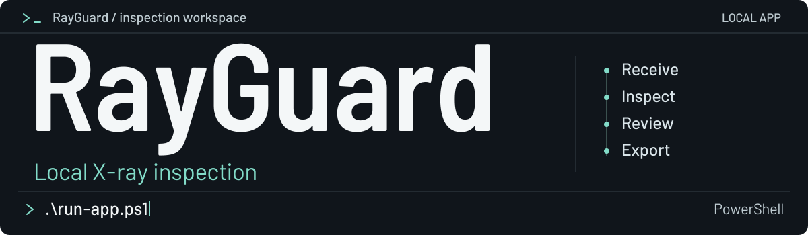
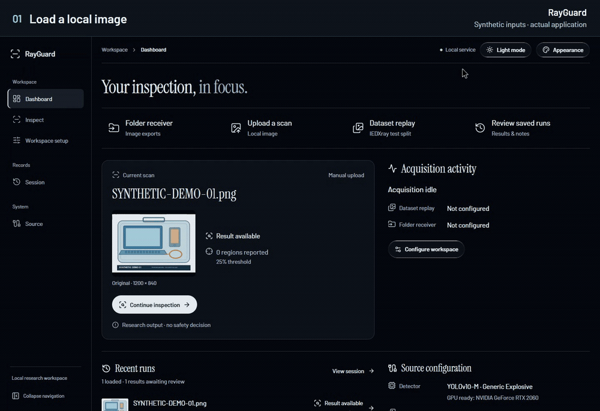

<h1 align="center">RayGuard App</h1>

<p align="center">
  
</p>

<p align="center">
  <strong>A local workspace for X-ray inspection.</strong><br>
  Receive images, inspect model results and keep the evidence in view.
</p>

<p align="center">
  <code>React + TypeScript</code> &nbsp; <code>FastAPI</code> &nbsp; <code>YOLOv10</code>
</p>

<p align="center">
  <a href="#see-it-in-action">Watch the demo</a> &nbsp;·&nbsp;
  <a href="#clone-and-start">Get started</a> &nbsp;·&nbsp;
  <a href="docs/usage.md">Usage guide</a> &nbsp;·&nbsp;
  <a href="CONTRIBUTING.md">Contribute</a>
</p>

## See it in action

**Load → run → inspect → review.** A short walkthrough of the actual application
using visibly synthetic sample images and the configured detector.

[](docs/images/gui-demo.mp4)

[Watch or download the sharper MP4](docs/images/gui-demo.mp4) · 34 seconds · Silent ·
[Capture notes](docs/images/README.md)

The sample images are synthetic demonstration inputs. The recording illustrates
the interface and actual execution, not detector accuracy or a safety assessment.
No research scans are included in these assets.
Edited for pacing: 12 seconds of inference waiting were removed.
The walkthrough was recorded before the 27 September A04 branding refresh;
its original application footage is preserved.

## About

A local X-ray inspection interface for the RayGuard research project: upload or
receive images, inspect real model detections, compare eligible test references,
record review notes and export evidence. Empty detections do not mean safe or benign.

The current approved logo is **A03 · Cobalt / controlled refinement**, selected
28 September. Its unchanged transparent master has a dedicated
[asset folder](assets/logo/a03-cobalt-controlled-refinement/README.md); earlier designs
are archived locally. The app currently renders the previous A04-02 Optical/Manrope 650
artwork. See the [identity and asset guide](docs/branding.md) for approval and runtime state.

GUI direction and repository maintenance: **Abd Alrahman Basim Ismaik**
([@abdalrahman-ismaik](https://github.com/abdalrahman-ismaik)). Development includes
AI-assisted implementation and verification. See [credits and provenance](CREDITS.md)
for the distinction between app work, team research and upstream models/assets.

The [SDP-I-RayGuard project](https://github.com/abdalrahman-ismaik/SDP-I-RayGuard)
remains the source of research requirements, the team backlog, prediction contracts
and the training study. This repository is self-contained: the inference engine
lives in its own [`engine/`](engine/README.md) folder (copied from SDP on 27 November
2026), so the app needs no SDP checkout and no Git submodule.

## Latest updates (27 November 2026)

- **Fresh start on every launch.** `run-app.ps1` stops earlier RayGuard processes
  (and their child processes) before it starts. Another program on the chosen port
  stops the launch with a message instead of being stopped.
- **Self-contained repository.** The engine is part of this repository instead of
  a Git submodule. A normal `git clone` is enough.
- **Tuned generic detector.** The fine-tuned Generic Explosive checkpoint is
  selectable in the app and published as a
  [release asset](https://github.com/abdalrahman-ismaik/RayGuard-App/releases/tag/tuned-model-v1).
  See [Tuned model](#tuned-model) below.
- **Verification on 27 November:** the engine suite (143 tests) and the launcher
  tests passed. The untuned detector was run on three published test scans from
  this checkout: Test001489 gave one detection (score 0.916); Test000001 (a known
  miss) and Test003370 (an empty result) gave none. A three-image dataset replay
  completed. With the tuned model downloaded from the release, the app's model
  verification passed and the same three scans gave: Test001489 one detection
  (score 0.954), Test000001 and Test003370 none.

## Clone and start

Install Git, Python 3.12, [uv](https://docs.astral.sh/uv/) and Node.js 22.12 or newer.

```powershell
git clone https://github.com/abdalrahman-ismaik/RayGuard-App.git
cd RayGuard-App
```

A clone made before 27 November 2026 still has the old submodule. Run
`git pull`, then delete the empty `engine` folder if Git reports it, and run
`git checkout -- engine`.

On Windows, run `./run-app.ps1` from PowerShell. It builds the locked frontend and
starts one local API service. The normal address is <http://127.0.0.1:8765>;
Ctrl+C stops the service. Each launch first stops RayGuard processes left by an
earlier launch and then starts a fresh session; only processes whose command line
names the RayGuard service and this checkout are stopped. `-Port`, `-Config`
and `-SkipBuild` support another port, an explicit local config and a previously
built frontend. Model/device changes use the app's deliberate restart flow.

For a UI-only launch without preparing a model environment:

```powershell
npm --prefix frontend ci
npm --prefix frontend run build
uv run --project backend --locked rayguard-gui
```

The interface opens with inference unavailable until a model is configured.
Weights, datasets, private configuration and prior sessions are not in this repository.

## Portable CPU and NVIDIA inference

The Windows launcher can prepare the reviewed isolated CPU/NVIDIA environments
through the bundled engine. With no local configuration it follows the managed
setup path; `-SetupModel` explicitly prepares it again. This can download model
dependencies, but never checkpoints or datasets. Other platforms/vendors need
independent qualification; web/API installation alone does not qualify inference.

Copy [config.example.json](config.example.json) to ignored `config.local.json`
and provide authorized checkpoint and model-interpreter paths, or configure the
managed local file produced by setup. Paths resolve relative to the config file.
Use the pinned original YOLOv10 backend and exact catalog-bound artifacts.
The supported models are Generic Explosive (untuned and fine-tuned), Electronic
Devices and Specific Explosives; their class meanings remain distinct.

In **Workspace setup → Model & compute**, select the model and CPU/GPU together,
then **Apply and restart**. Real model verification is a separate explicit action.
Changed paths, code, devices or dependencies can invalidate earlier qualification.
Saved history and queues are session-only; export needed reviews before restarting.
See [runtime evidence and limits](docs/runtime-verification.md),
[model selection](docs/model-selection.md) and the [usage guide](docs/usage.md).

## Tuned model

The tuned model is the fine-tuned Generic Explosive detector from the SDP I study
(job 819, epoch 84). Its catalogue ID is `author-yolov10m-generic-tuned`.

- **Checkpoint:** `epoch-084.pt`, 132,945,129 bytes, SHA-256
  `097ff71eb741ce51ba053bc77512ba0916772c69ae8b4d7d50c0ef497e3f65f8`.
- **Download:** the file is too large for Git, so it is a
  [release asset](https://github.com/abdalrahman-ismaik/RayGuard-App/releases/tag/tuned-model-v1).
  From the app root run `./scripts/get-tuned-model.ps1`. It saves the file to the
  ignored `models/epoch-084.pt` and checks the SHA-256.
- **Configure:** in `config.local.json` set `"model_id": "author-yolov10m-generic-tuned"`,
  `"checkpoint": "models/epoch-084.pt"` and the SHA-256 above as
  `"checkpoint_sha256"`. Prepare the model environment as described above
  (`./run-app.ps1 -SetupModel`), start the app, then run **Verify model** once in
  **Workspace setup → Model & compute**.
- **Loading** uses the THU-MIG YOLOv10 fork (commit
  `453c6e38a51e9d1d5a2aa5fb7f1014a711913397`) in the isolated environment. The
  bundled inference script allows full-object loading only for this exact path
  and hash; it never changes the file.
- **Data and licence:** fine-tuned on the IEDXray dataset
  ([CC BY 4.0](https://doi.org/10.6084/m9.figshare.30784328)). The three untuned
  author checkpoints are not redistributed here; see
  [engine/models/README.md](engine/models/README.md).

## Use and develop

The [usage guide](docs/usage.md) covers navigation, viewing, folder reception,
dataset replay, reference comparison, review/export and restart recovery.
The [architecture](docs/architecture.md), [contribution guide](CONTRIBUTING.md)
and [current status](docs/status.md) describe the implementation and checks.

| Path | Responsibility |
|---|---|
| `run-app.ps1` | Single Windows launch entry point |
| `frontend/` | Dashboard, scan viewer, styles and browser tests |
| `backend/` | Local API, acquisition, model adapter and API tests |
| `engine/` | Bundled contracts, model catalogue, inference scripts and runtime profiles |
| `scripts/` | Helper scripts, such as downloading the tuned model |
| `docs/` | Architecture, usage, design decisions and verification |
| `config.example.json` | Portable configuration template; local copies stay ignored |

The [extraction record](docs/migration.md) documents the dependency pin, preserved
source history, 149 browser checks and real inference from this checkout.

This is a loopback research application. A physical scanner handoff, full P1/P2,
model accuracy and human showcase acceptance are not established by GUI tests.
The dated records in `docs/` preserve earlier SDP evidence; they do not imply
new model execution in this extracted checkout. Research deadlines and task
ownership remain in the [SDP backlog](https://github.com/abdalrahman-ismaik/SDP-I-RayGuard/blob/main/docs/tasks.md).
